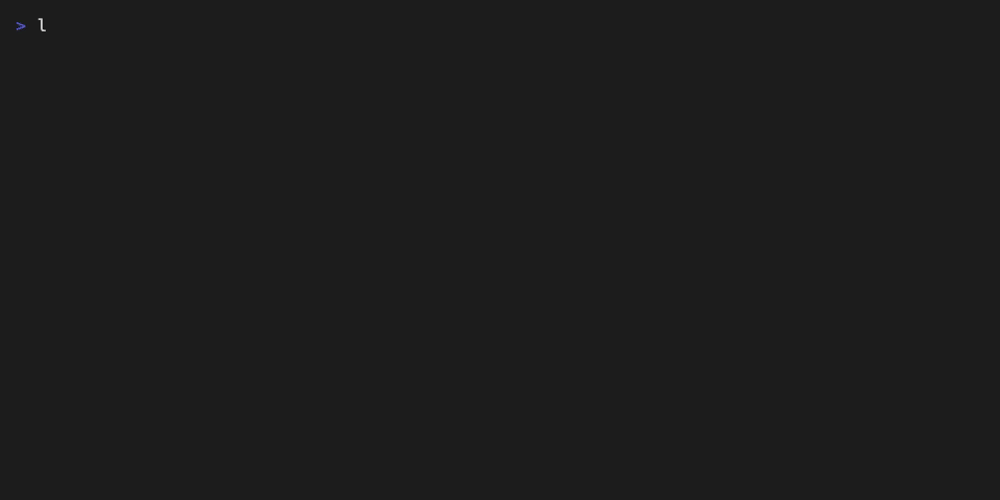

<div align="center">

# 🏁 llmrace

**Race LLM providers head-to-head in your terminal.**

Latency · Time-to-first-byte · Tokens/s · p95 · Cost — live, in one command.

[](https://github.com/dfbustosus/llmrace/actions)
[](https://crates.io/crates/llmrace)
[](https://codecov.io/gh/dfbustosus/llmrace)
[](#license)
[](https://www.rust-lang.org)

*A single static binary. No telemetry. Works with cloud APIs and local models.*

</div>

---

## Why

Every LLM provider claims to be "fast". **TTFB, streaming throughput and p95 tail latency tell a different story** depending on your region, your model and your prompt length. `llmrace` measures it for real: it fires the *same streaming request* at every provider **simultaneously**, watches the tokens arrive live, and ranks them.

## Contents

- [Why](#why) · [Demo](#demo) · [Install](#install) · [Quick start](#quick-start)
- [Tool calls](#using-llmrace-as-a-ci-quality-gate) · [Distributed probes](#distributed-probes)
- [Tracking over time](#tracking-providers-over-time) · [Diagnosing](#diagnosing-your-setup) · [Pricing](#pricing)
- [What it measures](#what-it-measures) · [Reports](#reports) · [Comparison](#how-it-compares)
- [Engineering](#engineering) · [Contributing](#contributing) · [License](#license)

## Demo



*A four-lane sweep race — local Ollama vs the instant mock lane across \`short\` and \`json\` prompt variants — followed by \`llmrace --doctor\` environment diagnostics. Reproducible via [`docs/demo.tape`](docs/demo.tape) ([vhs](https://github.com/charmbracelet/vhs)).*

## Why

```text
 🏁 llmrace   run 1/3 ·  4.2s · "Write one vivid paragraph about a lighthouse at dawn."
┌─ GROQ ────────────────────────────────────────────────────────────────┐
 │ 🏁 412 ms   184 tok  ·  TTFB 88 ms                                   │
 │ `llama-3.3-70b-versatile`                                            │
 │ ████████████████████████████████████████░░░░░░░░░░░░░░░              │
└───────────────────────────────────────────────────────────────────────┘
┌─ OPENAI ──────────────────────────────────────────────────────────────┐
 │ ▶ streaming…   61 tok  ·  TTFB 210 ms                                │
 │ `gpt-4o-mini`                                                        │
 │ ██████████████░░░░░░░░░░░░░░░░░░░░░░░░░░░░░░░░░░░░░░░░░░░             │
└───────────────────────────────────────────────────────────────────────┘
┌─ OLLAMA (local) ──────────────────────────────────────────────────────┐
 │ ▶ streaming…   23 tok  ·  TTFB 41 ms                                 │
 │ `llama3.2`                                                           │
 │ █████░░░░░░░░░░░░░░░░░░░░░░░░░░░░░░░░░░░░░░░░░░░░░░░░░░░░░░░░░░        │
└───────────────────────────────────────────────────────────────────────┘
q/Esc quit · report written on exit
```

## Install

**Homebrew (macOS & Linux):**

```bash
brew install dfbustosus/tap/llmrace
```

**Prebuilt binary** (no Rust toolchain needed):

```bash
cargo binstall llmrace
```

Or grab a binary for your platform from the [releases page](https://github.com/dfbustosus/llmrace/releases) — Linux (x86_64), macOS (Apple Silicon & Intel), Windows (x86_64), each with SHA-256 checksums.

**Shell completions:**

```bash
llmrace --completions zsh > ~/.zfunc/_llmrace   # or bash/fish/powershell/elvish
```

**From crates.io:**

```bash
cargo install llmrace
```

**From source:**

```bash
git clone https://github.com/dfbustosus/llmrace
cd llmrace && cargo install --path .
```

## Quick start

```bash
# Race every provider you have configured (auto-detected from env vars)
llmrace

# Race specific providers
llmrace openai anthropic groq

# Include your local Ollama models
llmrace ollama groq -m llama-3.3-70b-versatile

# Saturation throughput: 8 parallel requests per provider
llmrace openai groq -c 8 -n 5

# Prompt-variant sweep: same race across prompt shapes
llmrace openai groq --sweep short,long,code,json,reasoning

# Race ANY OpenAI-compatible endpoint (vLLM, LiteLLM, Together…)
llmrace --endpoint http://localhost:8000/v1/chat/completions \
        --provider-name vllm --api-key-env VLLM_API_KEY \
        openai groq

# Custom prompt, JSON + CSV output for CI
llmrace openai groq -p "Explain transformer attention in 3 sentences." -n 5 --json --csv
```

Every provider with a matching env var races automatically — no config file:

| Provider | Env var | Default model |
|----------|---------|---------------|
| `openai` | `OPENAI_API_KEY` | `gpt-4o-mini` |
| `anthropic` | `ANTHROPIC_API_KEY` | `claude-3-5-haiku-latest` |
| `gemini` | `GEMINI_API_KEY` | `gemini-2.0-flash` |
| `groq` | `GROQ_API_KEY` | `llama-3.3-70b-versatile` |
| `deepseek` | `DEEPSEEK_API_KEY` | `deepseek-chat` |
| `mistral` | `MISTRAL_API_KEY` | `mistral-small-latest` |
| `together` | `TOGETHER_API_KEY` | `Llama-3.3-70B-Instruct-Turbo` |
| `fireworks` | `FIREWORKS_API_KEY` | `llama-v3p3-70b-instruct` |
| `cerebras` | `CEREBRAS_API_KEY` | `llama-3.3-70b` |
| `xai` | `XAI_API_KEY` | `grok-3-mini` |
| `perplexity` | `PERPLEXITY_API_KEY` | `sonar` |
| `cohere` | `CO_API_KEY` | `command-a-03-2025` |
| `openrouter` | `OPENROUTER_API_KEY` | `openai/gpt-4o-mini` |
| `ollama` | — (local) | `llama3.2` |
| azure | `AZURE_OPENAI_API_KEY` (library: `ProviderSpec::azure_openai`) | per deployment |
| custom | `--endpoint` + `--api-key-env` | any OpenAI-compatible server |

## What it measures

| Metric | Definition |
|--------|------------|
| **TTFB** | Time from request to first streamed token |
| **Tokens/s** | Completion tokens divided by the *generation window* (total − TTFB); with `--concurrency N`, total tokens of all N parallel requests over the round window — i.e. saturation throughput |
| **Latency p50 / p95** | Distribution of round time-to-last-token (linear-interpolation percentiles) |
| **Mean ± 95% CI** | Student-t confidence interval on the mean latency |
| **Cost/run** | Provider-reported token counts × public per-model prices (editable in `src/cost.rs`) |

Methodology notes:

- One **warmup round** per provider (excluded from stats) to absorb connection setup and TLS handshakes
- Rounds are **concurrent across providers** but sequential within a provider, so providers don't throttle each other
- Rounds with 3σ latency outliers are flagged with `†`
- Token counts prefer **provider-reported usage** (`include_usage` on OpenAI-compatible APIs, `message_delta` on Anthropic) and fall back to stream-event counting
- All requests use the same prompt, `max_tokens` and sampling defaults per run
- Per-request timeouts (`--timeout`) are enforced mid-stream; panics in a single request never abort the race

## Reports

```bash
llmrace openai groq --out race.md --json --csv
```

- `race.md` — ranked table with **mean ± 95% CI**, p50/p95, TTFB, tokens/s and cost, ready to paste into GitHub issues or blog posts
- `race.json` — full per-run data, confidence intervals and outliers for CI pipelines
- `race.csv` — per-run rows for spreadsheets and dashboards

## Distributed probes

Run region-distributed probes from any workflow with the reusable [probe workflow](.github/workflows/probe.yml):

```yaml
jobs:
  probe:
    uses: dfbustosus/llmrace/.github/workflows/probe.yml@main
    with:
      providers: groq openai
      runs: 5
    secrets: inherit
```

Each run uploads a region-tagged JSON report artifact for merging into a shared history.

## Diagnosing your setup

```bash
llmrace --doctor            # keys, endpoint egress, Ollama, config, history
llmrace --doctor --json     # structured output for CI
llmrace --list --json       # full provider registry with availability
```

Any HTTP response counts as endpoint reachability — even a 401 proves DNS, TLS and routing work, so `--doctor` distinguishes "missing key" from "network blocked".

## Pricing

Cost columns use a built-in table that can drift as providers change prices. Override per model (repeatable, USD per million tokens):

```bash
llmrace openai --price openai/gpt-4o-mini=1.25:5
```

## Tracking providers over time

Record every race to a local history file (JSONL under `~/.local/share/llmrace/`):

```bash
llmrace openai groq --record
```

Then analyze drift — TTFB/throughput changes versus the rolling median, with model-swap annotations:

```bash
llmrace --trend              # last 30 days, all providers
llmrace --trend --days 7 groq
```

## Using llmrace as a CI quality gate

Record a baseline once, then fail your pipeline when a provider regresses:

```bash
# 1. Record the baseline (commit llmrace-report.json to your repo)
llmrace openai groq --json --out llmrace-report.json

# 2. In CI: race again and compare — exits 1 on regression
llmrace openai groq --baseline llmrace-report.json --max-regression 15
```

The check compares mean latency, p95, TTFB (increases) and tokens/s (decreases) against the threshold, prints an old → new diff table, and flags providers that are new or missing from the baseline.

## Real-world results

Measured with `llmrace ollama -m llama3.2:1b -n 5 --warmup 1` on Apple M5 Pro / 48 GB (local inference, 2026-11-08):

| Provider | Model | Latency (mean ± 95% CI) | p95 | TTFB | Tokens/s |
|---|---|---:|---:|---:|---:|
| ollama | `llama3.2:1b` | 2470 ± 397 ms | 2823 ms | < 1 ms | **60.2** |

Tool-calling mode (`--tools`, same machine, 3 rounds): the model returned **valid JSON tool arguments 3/3 rounds** with a full round-trip of ~19 ms.

Notes: sub-millisecond TTFB is real — a 1B model prefills a short prompt in single-digit milliseconds locally, while cloud providers add 200–800 ms of network + queueing before the first token. Reproduce on your machine with:

```bash
llmrace ollama -m llama3.2:1b -n 5 --warmup 1
```

PRs adding result tables from other regions and cloud providers are welcome — record with `--json` and open a PR against this section.

## How it compares

| | llmrace | provider CLIs | load testers (k6/vegeta) | router dashboards |
|---|---|---|---|---|
| Multi-provider streaming race | ✅ 12 + any OpenAI-compatible | one at a time | ✝ hand-written scripts | ❌ passive |
| TTFB / tokens/s / p95 / t-CI | ✅ built-in | varies | ✝ you build it | ✅ but only routed traffic |
| Live terminal race view | ✅ | ❌ | ❌ | ❌ |
| CI regression gate (`--baseline`) | ✅ | ❌ | ✝ heavy scripting | ❌ |
| Longitudinal trends + model-swap detection | ✅ | ❌ | ❌ | partial |
| Cost per run from real token usage | ✅ | ❌ | ❌ | partial |
| Single static binary, no config file | ✅ | ❌ | ❌ | ❌ |
| Fuzzed, bounded parser + typed errors | ✅ | — | — | — |

✝ possible with effort — llmrace exists so you don't spend that effort.
Missing a capability you need? [Open an issue](https://github.com/dfbustosus/llmrace/issues/new/choose).

## Engineering

- `#![deny(missing_docs)]` and `#![deny(clippy::unwrap_used)]` on the library
- Typed errors via `thiserror`; `anyhow` only at the binary edge
- Zero-alignment-allocation SSE parser that survives arbitrary network chunk boundaries (exhaustively tested at every split point)
- Criterion benchmarks for the parsing and statistics hot paths
- Panic containment: a failing request becomes an error row, never a crash
- CI on Linux/macOS/Windows: fmt + clippy `-D warnings` + tests + end-to-end mock race

## Roadmap

Tracked in [GitHub milestones](https://github.com/dfbustosus/llmrace/milestones) — highlights:

- **[v0.3.0](https://github.com/dfbustosus/llmrace/milestone/1)** — regression mode as a CI quality gate, Gemini + DeepSeek/Mistral/Together/Fireworks/Cerebras providers, config profiles, prompt-variant sweeps, watch mode, real-HTTP integration tests
- **[v0.4.0](https://github.com/dfbustosus/llmrace/milestone/2)** — Homebrew tap, code coverage, cargo-deny + dependabot, SSE fuzzing, MSRV enforcement, changelog discipline
- **[v1.0.0](https://github.com/dfbustosus/llmrace/milestone/3)** — persistent history + `llmrace trend`, community health files, stability guarantees

Most provider additions are tagged [`good first issue`](https://github.com/dfbustosus/llmrace/issues?q=is%3Aissue+is%3Aopen+label%3A%22good+first+issue%22) — grab one.

## Contributing

PRs welcome — adding a provider is ~40 lines (see `src/provider.rs`). Fork it, add your favorite provider, ship it.

## License

Dual-licensed under [MIT](LICENSE-MIT) or [Apache-2.0](LICENSE-APACHE) at your option.
